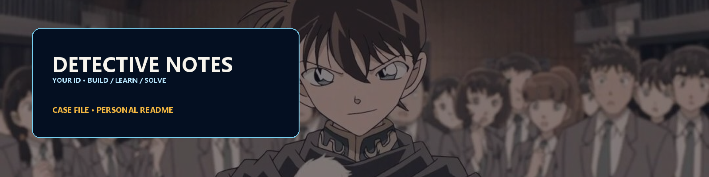
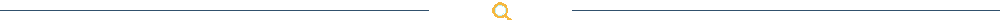
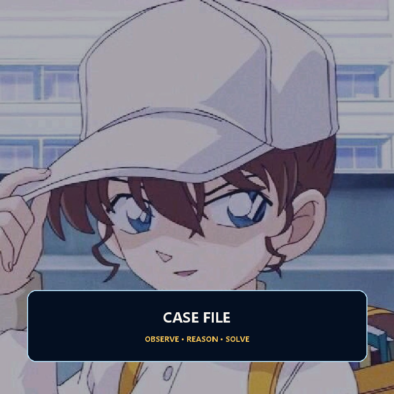
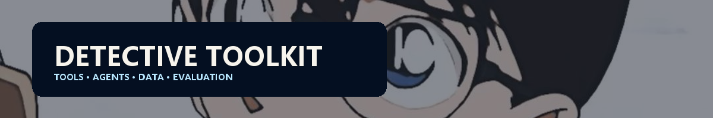
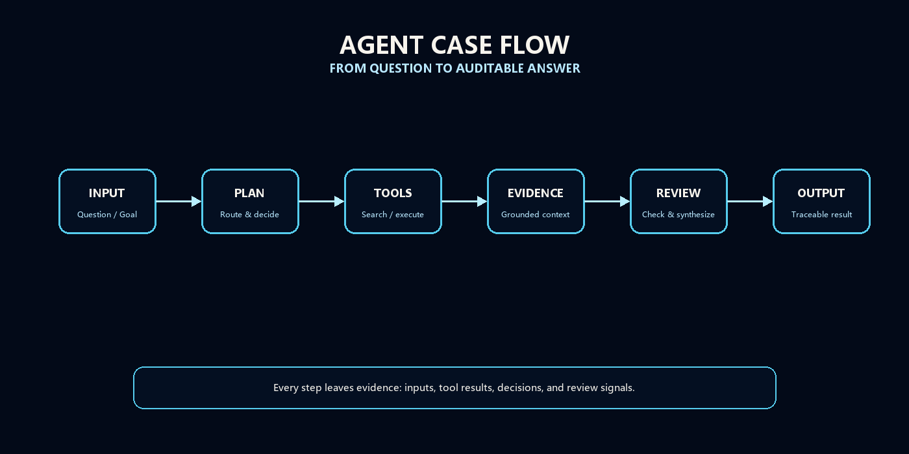
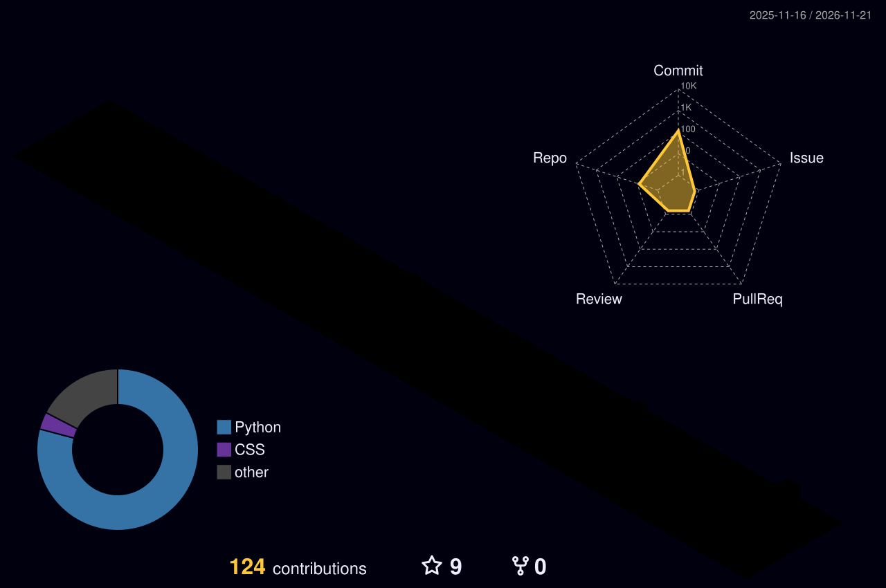

<!--
  ============================================================
  littlesheep920 / GitHub Profile README
  ============================================================
  部署位置：仓库 littlesheep920/littlesheep920 的根目录，文件名为 README.md
  图片：全部放在同级的 pic/ 文件夹，清单见 pic/README-图片清单.md
  说明：视觉层为侦探主题，正文为常规英文技术表述
  ============================================================
-->

<div align="center">

<!-- ═══ 图片位置 1/6：主横幅 banner.png ═══ -->


<br/><br/>

<!-- 打字机：开源项目 DenverCoder1/readme-typing-svg -->
<a href="https://github.com/DenverCoder1/readme-typing-svg">
  
</a>

<br/><br/>

<!-- 访客计数：开源项目 antonkomarev/github-profile-views-counter -->


</div>

<!-- ═══ 图片位置 2/6：分隔线 divider.png（本文件会重复使用 5 次）═══ -->


## About

<div align="center">
<table>
<tr>
<td width="38%" align="center" valign="middle">

<!-- ═══ 图片位置 3/6：插图 intro.png（建议 1:1 方图）═══ -->


</td>
<td width="62%" valign="top">

```yaml
name        : littlesheep920
role        : Undergraduate, Electronic Information Engineering
university  : Tianjin University
focus       : AI agent engineering / Python backend
stack       : Python · LangGraph · RAG · FastAPI
current work: SuperCoder — AI capability governance platform
```

- **Currently building** — SuperCoder, a platform for governing and orchestrating AI capabilities across enterprise R&D workflows
- **Areas of interest** — agent orchestration, tool calling, retrieval-augmented generation, multi-agent collaboration, evaluation
- **Engineering approach** — agents should plan, use tools, retain context, and leave an auditable trace of every step

</td>
</tr>
</table>
</div>

<!-- ═══ 分隔线 ═══ -->


## Tech Stack

<div align="center">

<!-- ═══ 图片位置 4/6：板块标题图 stack-header.png ═══ -->


<br/><br/>

<!-- 图标墙：开源项目 tandpfun/skill-icons -->


<br/><br/>

### Languages & Frameworks


### AI & Agents


<!-- 下面三个项目的 logo 已被 Simple Icons 移除，只能做纯文字徽章，属正常现象 -->


### Infrastructure & Tooling


</div>

<!-- ═══ 分隔线 ═══ -->


## Agent Architecture

<div align="center">

<!-- ═══ 图片位置 5/6：Agent 架构图 agent-flow.png ═══ -->


</div>

| Module | Responsibility | Implementation |
| :--- | :--- | :--- |
| **Planner** | Break down goals and decide the next step | LLM planning with a ReAct loop |
| **Tool Use** | Call external capabilities | Function calling / MCP servers |
| **Memory** | Retain context across turns | Session memory plus a long-term vector store |
| **RAG** | Ground answers in retrieved sources | Chroma vector search with re-ranking |
| **Multi-Agent** | Divide work across specialised agents | LangGraph state machine / CrewAI role design |
| **Evaluation** | Verify whether the output holds up | Trajectory replay and automated scoring |

<!-- ═══ 分隔线 ═══ -->


## Projects

| Repository | Description | Stack | Activity |
| :--- | :--- | :--- | :--- |
| **[SuperCoder](https://github.com/littlesheep920/SuperCoder)** | AI capability governance and orchestration platform for enterprise R&D workflows. Six resource protocols, a seven-state lifecycle model, hybrid retrieval and an evaluation pipeline, with six frozen contract documents carrying the same authority as the code | `Python` `FastAPI` `MySQL` `Hybrid Retrieval` |   |
| **[FTO-AGENT](https://github.com/littlesheep920/FTO-AGENT)** | Multi-agent freedom-to-operate analysis system for the Chinese jurisdiction, focused on steerable catheters. Delegates patent infringement screening to agents that gather evidence and compare claims item by item | `FastAPI` `LangGraph` `Tortoise ORM` `MySQL` |  |
| **[ai-agent-learning](https://github.com/littlesheep920/ai-agent-learning)** | Retrieval-augmented question answering: document chunking, embedding, vector search, prompt assembly and generation. Ships both a CLI and a Gradio web interface | `LangChain` `Chroma` `GLM-4-Flash` `Gradio` |  |
| **[pdf-textbook-slides](https://github.com/littlesheep920/pdf-textbook-slides)** | Converts textbook and course-material PDFs, including scanned documents, into single-file HTML slide decks for teaching, and exports them as 16:9 PDFs. Includes rendering, chunk stitching, crop QA and export scripts | `Python` `PDF Processing` |  |

<div align="center">

<a href="https://github.com/littlesheep920?tab=repositories">
  
</a>

</div>

<!-- ═══ 分隔线 ═══ -->


## GitHub Activity

<div align="center">

<!-- 开源项目 anuraghazra/github-readme-stats -->


<br/>

<!-- 开源项目 DenverCoder1/github-readme-streak-stats -->


<br/>

<!-- 开源项目 Ashutosh00710/github-readme-activity-graph -->


<br/>

<!-- 开源项目 Platane/snk（贪吃蛇吃掉贡献格，需开启 Actions 工作流）-->
<picture>
  <source media="(prefers-color-scheme: dark)" srcset="https://raw.githubusercontent.com/littlesheep920/littlesheep920/output/github-contribution-grid-snake-dark.svg" />
  <source media="(prefers-color-scheme: light)" srcset="https://raw.githubusercontent.com/littlesheep920/littlesheep920/output/github-contribution-grid-snake.svg" />
  
</picture>

<br/><br/>

<!-- 开源项目 yoshi389111/github-profile-3d-contrib（需开启 Actions 工作流）-->


<br/>

<!-- 开源项目 ryo-ma/github-profile-trophy -->


</div>

<!-- ═══ 分隔线 ═══ -->


<div align="center">

<!-- ═══ 图片位置 6/6：结尾横幅 footer.png ═══ -->


<br/><br/>

<a href="mailto:3023234119@tju.edu.cn">
  
</a>
<a href="https://github.com/littlesheep920">
  
</a>

<br/><br/>

<sub>Built with <a href="https://github.com/anuraghazra/github-readme-stats">github-readme-stats</a> ·
<a href="https://github.com/DenverCoder1/readme-typing-svg">readme-typing-svg</a> ·
<a href="https://github.com/DenverCoder1/github-readme-streak-stats">streak-stats</a> ·
<a href="https://github.com/tandpfun/skill-icons">skill-icons</a> ·
<a href="https://github.com/Platane/snk">snk</a> ·
<a href="https://github.com/yoshi389111/github-profile-3d-contrib">3d-contrib</a></sub>

</div>
