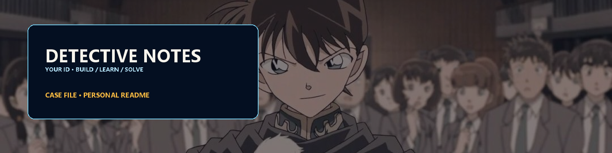
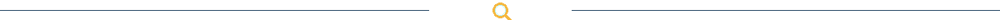
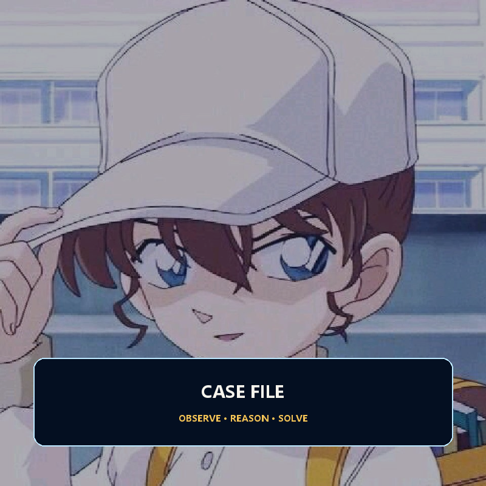
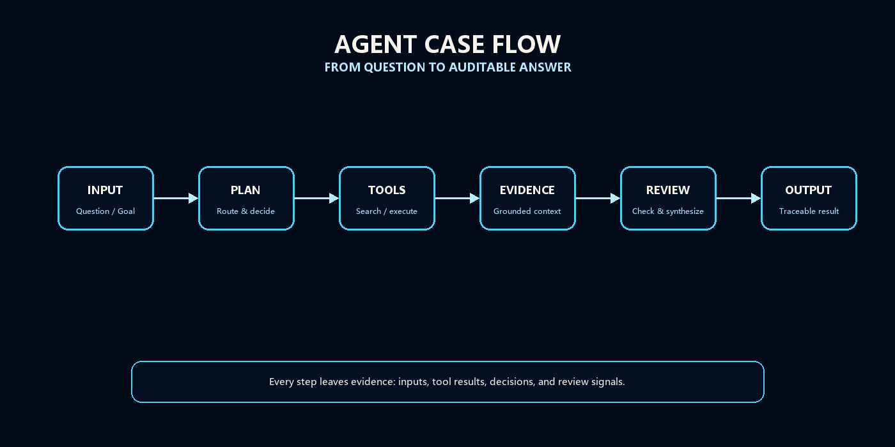
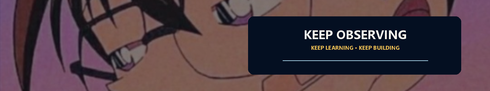

<!--
  ============================================================
  名探偵 PROFILE  /  Conan-Themed GitHub Profile README
  ============================================================
  部署位置：仓库 littlesheep920/littlesheep920 的根目录，文件名为 README.md
  图片：全部放在同级的 pic/ 文件夹，清单见 pic/README-图片清单.md
  ============================================================
-->

<div align="center">

<!-- ═══ 图片位置 1/6：主横幅 banner.png ═══ -->


<br/><br/>

<!-- 打字机：开源项目 DenverCoder1/readme-typing-svg -->
<a href="https://github.com/DenverCoder1/readme-typing-svg">
  
</a>

<br/><br/>

<!-- 访客计数：开源项目 antonkomarev/github-profile-views-counter -->


</div>

<!-- ═══ 图片位置 2/6：分隔线 divider.png（本文件会重复使用 5 次）═══ -->


## 📁 CASE FILE — 本人档案

<div align="center">
<table>
<tr>
<td width="38%" align="center" valign="middle">

<!-- ═══ 图片位置 3/6：名台词插图 intro.png（建议 1:1 方图）═══ -->


</td>
<td width="62%" valign="top">

> **「真実はいつもひとつ」**
> — 真相只有一个。

```yaml
代号     : littlesheep920
身份     : 天津大学 · 电子信息工程 在读
方向     : AI Agent 工程 / Python 后端
常用装备 : Python · LangGraph · RAG · FastAPI
推理工具 : 代码 / 日志 / 向量检索
当前任务 : 把 LLM 从「会聊天」带成「能办事」
座右铭   : 排除所有不可能，剩下的再离谱也是真相
```

- 🔍 **正在做的事** — 用多 Agent 系统做 FTO（自由实施）专利侵权分析
- 🧠 **关注领域** — Agent 编排 · 工具调用 · RAG 检索增强 · 多智能体协作
- 🎯 **追踪的目标** — 让 Agent 能自主规划、调用工具、记得住上下文

</td>
</tr>
</table>
</div>

<!-- ═══ 分隔线 ═══ -->


## 🔬 推理装备 — 技术栈

<div align="center">

<!-- ═══ 图片位置 4/6：板块标题图 stack-header.png ═══ -->


<br/><br/>

<!-- 图标墙：开源项目 tandpfun/skill-icons -->


<br/><br/>

### 🐍 主武器 — Python 生态


### 🤖 特殊装备 — Agent 与 LLM


<!-- 下面三个项目的 logo 已被 Simple Icons 移除，只能做纯文字徽章，属正常现象 -->


### 🧰 后勤 — 工程化


</div>

<!-- ═══ 分隔线 ═══ -->


## 🕵️ 事件簿 — Agent 架构

<div align="center">

<!-- ═══ 图片位置 5/6：Agent 架构图 agent-flow.png ═══ -->


</div>

| 模块 | 职责 | 我的实现 |
| :--- | :--- | :--- |
| 🧭 **Planner** | 拆解目标、决定下一步 | LLM 规划 + ReAct 循环 |
| 🛠️ **Tool Use** | 调用外部能力 | Function Calling / MCP Server |
| 🧠 **Memory** | 记住上下文与历史 | 短期会话记忆 + 长期向量库 |
| 📚 **RAG** | 检索证据再回答 | Chroma 向量检索 + 重排序 |
| 👥 **Multi-Agent** | 多个 Agent 分工协作 | LangGraph 状态机 / CrewAI 角色制 |
| ✅ **Evaluation** | 判断推理对不对 | 轨迹回放 + 自动评分 |

<!-- ═══ 分隔线 ═══ -->


## 📌 进行中的案件 — Projects

| 案件 | 案情 | 装备 |
| :--- | :--- | :--- |
| 🏛️ **[FTO-AGENT](https://github.com/littlesheep920/FTO-AGENT)** | 多 Agent 专利自由实施（FTO）分析系统，面向中国法域 · 控弯导管领域。把「查专利是否侵权」这件苦力活交给 Agent 去搜集证据、逐条比对 | `FastAPI` `LangGraph` `Tortoise ORM` `MySQL` |
| 🧪 **[ai-agent-learning](https://github.com/littlesheep920/ai-agent-learning)** | RAG 知识问答系统：文档切分 → Embedding → 向量检索 → Prompt 组装 → 生成回答，含命令行版与 Gradio 网页版 | `LangChain` `Chroma` `GLM-4-Flash` `Gradio` |
| 📚 **[pdf-textbook-slides](https://github.com/littlesheep920/pdf-textbook-slides)** | 把教辅／教材 PDF（含扫描件）转成讲课讲题用的单文件 HTML 幻灯片，并导出 16:9 PDF。含渲染、分片拼接、裁切质检、导出四个脚本 | `Python` `PDF 处理` |

<div align="center">

<a href="https://github.com/littlesheep920?tab=repositories">
  
</a>

</div>

<!-- ═══ 分隔线 ═══ -->


## 🔎 证据链 — GitHub 战绩

<div align="center">

<!-- 开源项目 anuraghazra/github-readme-stats -->


<br/>

<!-- 开源项目 DenverCoder1/github-readme-streak-stats -->


<br/>

<!-- 开源项目 Ashutosh00710/github-readme-activity-graph -->


<br/>

<!-- 开源项目 Platane/snk（贪吃蛇吃掉贡献格，需开启 Actions 工作流）-->
<picture>
  <source media="(prefers-color-scheme: dark)" srcset="https://raw.githubusercontent.com/littlesheep920/littlesheep920/output/github-contribution-grid-snake-dark.svg" />
  <source media="(prefers-color-scheme: light)" srcset="https://raw.githubusercontent.com/littlesheep920/littlesheep920/output/github-contribution-grid-snake.svg" />
  
</picture>

<br/><br/>

<!-- 开源项目 yoshi389111/github-profile-3d-contrib（需开启 Actions 工作流）-->


<br/>

<!-- 开源项目 ryo-ma/github-profile-trophy -->


</div>

<!-- ═══ 分隔线 ═══ -->


<div align="center">

<!-- ═══ 图片位置 6/6：结尾横幅 footer.png ═══ -->


<br/><br/>

> **真相只有一个，但通往真相的路不止一条。**

<br/>

<!-- 联系我 -->
<a href="mailto:3023234119@tju.edu.cn">
  
</a>
<a href="https://github.com/littlesheep920">
  
</a>

<br/><br/>

<sub>本页由 <a href="https://github.com/anuraghazra/github-readme-stats">github-readme-stats</a> ·
<a href="https://github.com/DenverCoder1/readme-typing-svg">readme-typing-svg</a> ·
<a href="https://github.com/DenverCoder1/github-readme-streak-stats">streak-stats</a> ·
<a href="https://github.com/tandpfun/skill-icons">skill-icons</a> ·
<a href="https://github.com/Platane/snk">snk</a> ·
<a href="https://github.com/yoshi389111/github-profile-3d-contrib">3d-contrib</a>
等开源项目驱动</sub>

</div>
